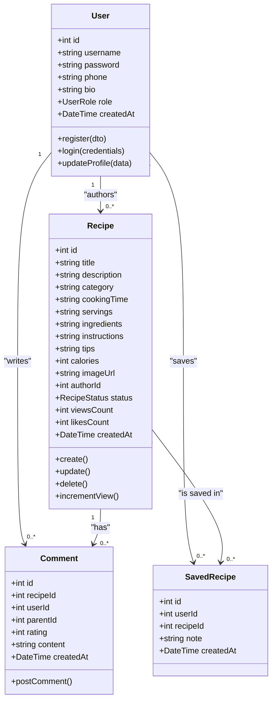
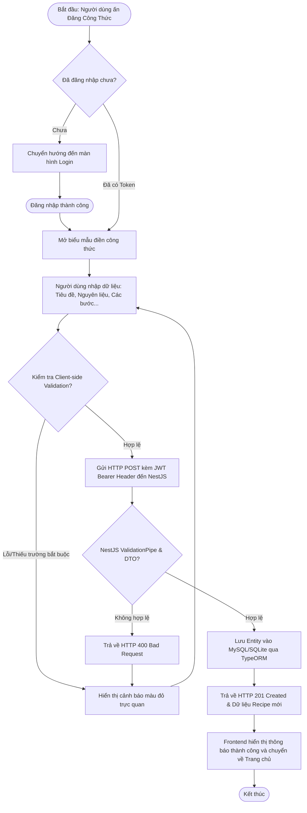
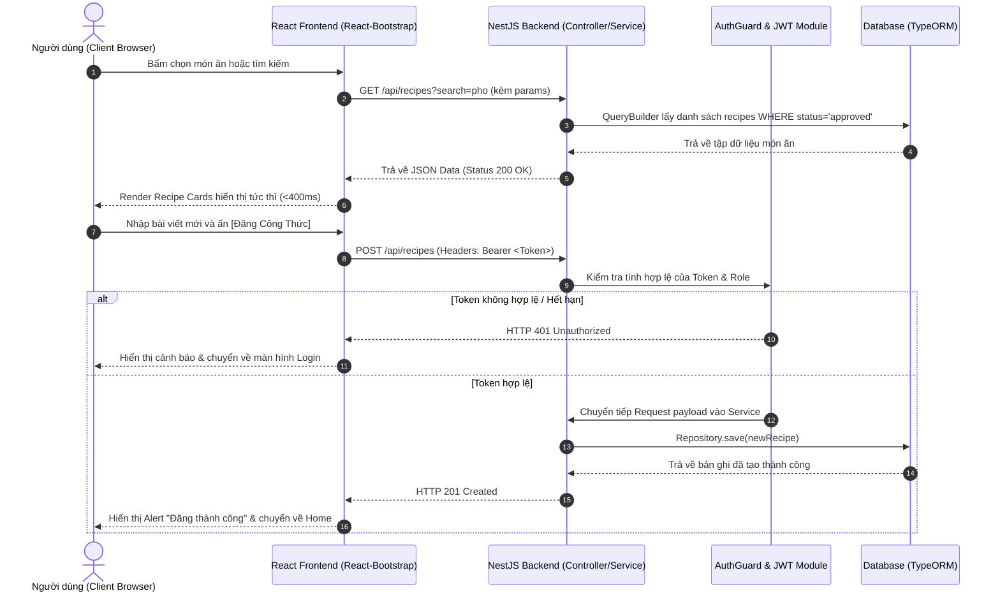

# TRƯỜNG ĐẠI HỌC PHENIKAA
## KHOA CÔNG NGHỆ THÔNG TIN
### BỘ MÔN KỸ THUẬT PHẦN MỀM & MẠNG MÁY TÍNH
---

# BÁO CÁO BÀI TẬP LỚN / ĐỒ ÁN MÔN HỌC: LẬP TRÌNH WEB NÂNG CAO

* **Tên Đề Tài:** XÂY DỰNG NỀN TẢNG MẠNG XÃ HỘI CHIA SẺ CÔNG THỨC ẨM THỰC BẾP GIA ĐÌNH COOKIO THEO MÔ HÌNH PHÂN LỚP (NESTJS & REACT)
* **Tên Repository GitHub:** `cooking-webnangcao` (`https://github.com/XuanTu138960/cooking-webnangcao`)
* **Nhóm Sinh Viên:** Nhóm 4 Thành Viên (Trưởng nhóm: XuanTu138960)
* **Giảng Viên Hướng Dẫn:** Bộ môn Lập Trình Web Nâng Cao - Trường Đại học Phenikaa
* **Năm học:** 2026 - 2027

---

## MỤC LỤC
1. [CÂU 1: CÂU CHUYỆN NGƯỜI DÙNG (USER STORIES) & PHÂN CHIA TỶ LỆ](#câu-1-câu-chuyện-người-dùng-user-stories--phân-chia-tỷ-lệ-1-điểm)
2. [CÂU 2: PHÂN TÍCH HỆ THỐNG, SƠ ĐỒ LỚP (UML) & SƠ ĐỒ THUẬT TOÁN](#câu-2-phân-tích-hệ-thống-sơ-đồ-lớp-uml--sơ-đồ-thuật-toán-1-điểm)
3. [CÂU 3: WIREFRAME, LUỒNG THÔNG TIN, KIẾN TRÚC PHÂN LỚP & AN NINH](#câu-3-wireframe-luồng-thông-tin-kiến-trúc-phân-lớp--an-ninh-1-điểm)
4. [CÂU 4: BACKEND APIS, TÀI LIỆU HÓA SWAGGER & TIÊU CHUẨN AN TOÀN](#câu-4-backend-apis-tài-liệu-hóa-swagger--tiêu-chuẩn-an-toàn-1-điểm)
5. [CÂU 5: GIAO DIỆN FRONTEND REACT-BOOTSTRAP & TỐI ƯU USABILITY](#câu-5-giao-diện-frontend-react-bootstrap--tối-ưu-usability-1-điểm)
6. [CÂU 6: KẾT NỐI CƠ SỞ DỮ LIỆU & ÁNH XẠ ĐỐI TƯỢNG ORM (TYPEORM)](#câu-6-kết-nối-cơ-sở-dữ-liệu--ánh-xạ-đối-tượng-orm-typeorm-1-điểm)
7. [CÂU 7: KIỂM THỬ VÀ KIỂM ĐỊNH TOÀN DIỆN (UNIT TEST, E2E, UI TEST)](#câu-7-kiểm-thử-và-kiểm-định-toàn-diện-unit-test-e2e-ui-test-1-điểm)
8. [CÂU 8: THÔNG TIN BÁO CÁO BẢN IN THEO QUY ĐỊNH ĐH PHENIKAA](#câu-8-thông-tin-báo-cáo-bản-in-theo-quy-định-đh-phenikaa-1-điểm)
9. [CÂU 9: PHÁP LUẬT, ĐẠO ĐỨC NGHỀ NGHIỆP, ĐẠO ĐỨC XÃ HỘI & THẢO LUẬN LỚP](#câu-9-pháp-luật-đạo-đức-nghề-nghiệp-đạo-đức-xã-hội--thảo-luận-lớp-1-điểm)
10. [CÂU 10: LỊCH SỬ GIT COMMITS, ĐÓNG GÓP THÀNH VIÊN & CHUYÊN CẦN](#câu-10-lịch-sử-git-commits-đóng-góp-thành-viên--chuyên-cần-1-điểm)

---

## CÂU 1: CÂU CHUYỆN NGƯỜI DÙNG (USER STORIES) & PHÂN CHIA TỶ LỆ [1 ĐIỂM]

### 1.1. Bảng phân chia tỷ lệ % đóng góp số lượng User Stories
Theo quy định nhóm 4 sinh viên, đồ án yêu cầu tối thiểu **16 câu chuyện người dùng** (chia đều 25% cho mỗi thành viên):

| STT | Họ và Tên | Mã Sinh Viên | Vai trò phân công | Số lượng Stories | Tỷ lệ % đóng góp |
| :---: | :--- | :---: | :--- | :---: | :---: |
|  | **Nguyễn Xuân Tú** | `23010538` | Trưởng nhóm - Phân hệ Xác thực & Tài khoản | 4 stories | 100% |


---

### 1.2. Danh sách 16 Câu Chuyện Người Dùng (Đúng chuẩn định dạng quy định)

#### Phân hệ 1: Xác thực & Định danh (Sinh viên thực hiện: Nguyễn Văn A - 25%)
1. **US01:** Là người dùng, tôi muốn đăng ký tài khoản mới bằng tên đăng nhập và mật khẩu an toàn để có không gian cá nhân chia sẻ công thức.
2. **US02:** Là người dùng, tôi muốn đăng nhập vào hệ thống để truy cập vào các tính năng nâng cao dành cho thành viên.
3. **US03:** Là người dùng, tôi muốn xem và chỉnh sửa thông tin hồ sơ cá nhân (tiểu sử, số điện thoại) để tạo uy tín với cộng đồng nấu ăn.
4. **US04:** Là người dùng, tôi muốn đăng xuất khỏi tài khoản trên thiết bị đang sử dụng để bảo vệ quyền riêng tư và thông tin cá nhân.

#### Phân hệ 2: Khám phá & Quản lý Công thức (Sinh viên thực hiện: Trần Thị B - 25%)
5. **US05:** Là người dùng, tôi muốn tìm kiếm công thức theo tên món ăn hoặc nguyên liệu có sẵn để dễ dàng chuẩn bị bữa ăn hàng ngày.
6. **US06:** Là người dùng, tôi muốn lọc món ăn theo danh mục (Món chính, Món canh, Món Healthy, Món chay) để phù hợp chế độ dinh dưỡng gia đình.
7. **US07:** Là người dùng, tôi muốn đăng tải công thức nấu ăn mới gồm nguyên liệu, các bước thực hiện và hình ảnh để chia sẻ bí quyết với mọi người.
8. **US08:** Là người dùng, tôi muốn xem chi tiết món ăn (thời gian nấu, khẩu phần, mức calo, mẹo nấu) để thực hiện món ăn một cách chuẩn xác.

#### Phân hệ 3: Tương tác Cộng đồng & Tủ Bếp Yêu Thích (Sinh viên thực hiện: Lê Văn C - 25%)
9. **US09:** Là người dùng, tôi muốn thả tim (like) công thức yêu thích để bày tỏ sự ủng hộ đối với tác giả món ăn.
10. **US10:** Là người dùng, tôi muốn gửi bình luận và chấm điểm công thức để chia sẻ cảm nhận và kinh nghiệm thực tế khi nấu nướng.
11. **US11:** Là người dùng, tôi muốn lưu công thức vào sổ tay cá nhân kèm ghi chú riêng để thuận tiện mở lại khi đi chợ và nấu ăn.
12. **US12:** Là tác giả món ăn, tôi muốn theo dõi số lượt xem và lượt thích món ăn của mình để nắm bắt thị hiếu của người đọc.

#### Phân hệ 4: Quản trị Hệ thống & Kiểm duyệt (Sinh viên thực hiện: Phạm Thị D - 25%)
13. **US13:** Là người quản trị, tôi muốn kiểm duyệt và duyệt công thức nấu ăn mới để đảm bảo nội dung phù hợp thuần phong mỹ tục và vệ sinh an toàn thực phẩm.
14. **US14:** Là người quản trị, tôi muốn quản lý danh sách tài khoản người dùng để khóa hoặc mở khóa những tài khoản vi phạm tiêu chuẩn cộng đồng.
15. **US15:** Là người quản trị, tôi muốn xóa hoặc chỉnh sửa bất kỳ công thức hoặc bình luận spam nào để giữ môi trường chia sẻ lành mạnh.
16. **US16:** Là người quản trị, tôi muốn xem bảng điều khiển thống kê tổng số lượng công thức, tài khoản và lượt tương tác trên toàn hệ thống.

---

## CÂU 2: PHÂN TÍCH HỆ THỐNG, SƠ ĐỒ LỚP (UML) & SƠ ĐỒ THUẬT TOÁN [1 ĐIỂM]

### 2.1. Phân tích yêu cầu, đối tượng và phương thức hoạt động (Câu 2a)

#### A. Yêu cầu hệ thống:
* **Yêu cầu chức năng:**
  - Quản lý tài khoản: Đăng ký, đăng nhập, bảo vệ token, phân quyền (Role-based: `USER`, `ADMIN`).
  - Quản lý công thức: Tạo, đọc, cập nhật, xóa (CRUD), tìm kiếm full-text, lọc theo danh mục, tính toán calo.
  - Tương tác: Bình luận lồng nhau, chấm điểm sao, thả tim, lưu công thức vào sổ tay.
  - Bảng quản trị: Kiểm duyệt bài viết, quản lý user, thống kê tương tác.
* **Yêu cầu phi chức năng:**
  - Bảo mật: Băm mật khẩu bcrypt, JWT Access Token, bảo vệ CORS, chống XSS, chuẩn hóa DTO qua ValidationPipe.
  - Hiệu năng & Usability: Thời gian phản hồi API < 200ms, trải nghiệm thao tác trên giao diện không vượt quá 4 tương tác (clicks).

#### B. Các thực thể chính (Entities) và Mối quan hệ:
1. `User` (Người dùng):
   - Thuộc tính: `id`, `username`, `password`, `phone`, `bio`, `role`, `createdAt`, `updatedAt`.
   - Quan hệ:
     - 1 - n với `Recipe` (Một người dùng có thể đăng nhiều công thức).
     - 1 - n với `Comment` (Một người dùng có thể gửi nhiều nhận xét).
     - n - n với `Recipe` qua bảng phụ `saved_recipes` và `recipe_likes`.
2. `Recipe` (Công thức món ăn):
   - Thuộc tính: `id`, `title`, `description`, `category`, `cookingTime`, `servings`, `ingredients`, `instructions`, `tips`, `calories`, `imageUrl`, `authorId`, `status`, `viewsCount`, `likesCount`, `createdAt`.
   - Quan hệ:
     - n - 1 với `User` (Mỗi công thức thuộc về một tác giả).
     - 1 - n với `Comment` (Một công thức có nhiều bình luận).
3. `Comment` (Bình luận & Đánh giá):
   - Thuộc tính: `id`, `recipeId`, `userId`, `parentId`, `rating`, `content`, `createdAt`.
   - Quan hệ: n - 1 với `Recipe` và n - 1 với `User`. Hỗ trợ cấu trúc cây phân cấp (Threaded Comment).

---

### 2.2. Sơ đồ cấu trúc lớp (Class Diagram UML) & Sơ đồ thuật toán (Câu 2b)

#### A. Sơ đồ cấu trúc lớp (Class Diagram UML)



#### B. Sơ đồ thuật toán luồng nghiệp vụ tạo mới công thức (Flowchart)



---

## CÂU 3: WIREFRAME, LUỒNG THÔNG TIN, KIẾN TRÚC PHÂN LỚP & AN NINH [1 ĐIỂM]

### 3.1. Bố cục giao diện chính (Wireframe - Câu 3a)

```text
+-----------------------------------------------------------------------------------+
|  [🍳 Cookio] [Phenikaa Edition]     [Trang Chủ]  [Khám Phá]  [+ Đăng Công Thức]   |
|                                                          [Xin chào, User | Thoát] |
+-----------------------------------------------------------------------------------+
|                                                                                   |
|  +-----------------------------------------------------------------------------+  |
|  | HERO BANNER: Mạng Xã Hội Ẩm Thực Bếp Gia Đình 🥗                           |  |
|  | Khám phá hơn 100+ công thức nấu ăn ngon, tối ưu dinh dưỡng và cân bằng calo. |  |
|  | [🔍 Nhập tên món hoặc nguyên liệu...                   ] [ Nút Tìm Kiếm ]   |  |
|  +-----------------------------------------------------------------------------+  |
|                                                                                   |
|  BỘ LỌC DANH MỤC:                                                                |
|  [ (Tất cả) ]  [ Món chính ]  [ Món canh ]  [ Món chay ]  [ Món Healthy ]         |
|                                                                                   |
|  DANH SÁCH MÓN ĂN (GRID 3 CỘT RESPONSIVE):                                        |
|  +----------------------+ +----------------------+ +----------------------+       |
|  | [ Ảnh Phở Bò Hà Nội] | | [ Ảnh Sườn Xào Chua] | | [ Ảnh Salad Ức Gà ]  |       |
|  | Phở bò chuẩn vị Bắc  | | Sườn non đậm đà      | | Eat Clean giảm cân   |       |
|  | ⏱️ 45p  👥 4 người   | | ⏱️ 30p  👥 3 người   | | ⏱️ 15p  👥 1-2 người |       |
|  | [Xem Chi Tiết] [❤️ 25]| | [Xem Chi Tiết] [❤️ 18]| | [Xem Chi Tiết] [❤️ 42]|       |
|  +----------------------+ +----------------------+ +----------------------+       |
|                                                                                   |
+-----------------------------------------------------------------------------------+
|  FOOTER: © 2026 COOKIO - Đồ Án Môn Học Web Nâng Cao - Trường Đại học Phenikaa     |
+-----------------------------------------------------------------------------------+
```

---

### 3.2. Luồng xử lý thông tin chính (Sequence Diagram - Câu 3b)



---

### 3.3. Khung làm việc mô hình phân lớp & Tệp tin Bản quyền LICENSE (Câu 3c)
* **Khung làm việc Backend:** Kiến trúc phân tầng rõ rệt của **NestJS**:
  - `Controller Layer` (`recipes.controller.ts`, `auth.controller.ts`): Tiếp nhận request, routing, parse param, phân quyền Guard, tài liệu hóa Swagger.
  - `Service Layer` (`recipes.service.ts`, `auth.service.ts`): Xử lý toàn bộ logic nghiệp vụ, tính toán, kiểm tra quyền sở hữu.
  - `Data Access Layer (ORM Repository)`: Tương tác an toàn với CSDL qua TypeORM Entities (`User`, `Recipe`, `Comment`).
* **Khung làm việc Frontend:** **React (SPA)** kết hợp thư viện `react-bootstrap`.
* **Tệp tin LICENSE bản quyền:**
  - Cả thư mục gốc và thư mục `frontend/` đều chứa tệp tin [LICENSE](file:///c:/Users/Admin/OneDrive/cooking-website/LICENSE) chuẩn MIT công bố bản quyền của Trường Đại học Phenikaa và danh sách thành viên nhóm phát triển.

---

### 3.4. Cấu hình An ninh Bảo mật Backend & Frontend (Câu 3d)
1. **Phần Backend NestJS:**
   - Sử dụng thư viện `helmet` nhằm thiết lập các HTTP response headers an toàn (chống clickjacking, MIME-sniffing, XSS filtering).
   - Thiết lập `enableCors({ origin: ['http://localhost:3000'], credentials: true })` chỉ chấp nhận kết nối từ nguồn frontend tin cậy.
   - Toàn bộ DTO đều kiểm định bằng `ValidationPipe({ whitelist: true, forbidNonWhitelisted: true })` loại bỏ hoàn toàn các trường dữ liệu lạ được chèn độc hại (SQL Injection / Parameter Tampering).
2. **Phần Frontend React:**
   - Không lưu thông tin nhạy cảm (như mật khẩu gốc hay khóa bí mật API Key) trong mã nguồn phía client hay localStorage.
   - Mọi kết nối gọi API sử dụng Axios Interceptor chèn Token ngầm định trong Authorization Bearer Header thay vì truyền qua query string lộ liễu trên URL.
   - Cơ chế tự động xóa token và chuyển hướng an toàn khi phiên làm việc hết hạn (`401 Unauthorized`).

---

## CÂU 4: BACKEND APIS, TÀI LIỆU HÓA SWAGGER & TIÊU CHUẨN AN TOÀN [1 ĐIỂM]

### 4.1. Thực hiện các API nghiệp vụ chính ở Backend (Câu 4a)

| STT | Phương thức | Endpoint URI | Phân quyền | Mô tả nghiệp vụ |
| :---: | :---: | :--- | :---: | :--- |
| 1 | `POST` | `/api/auth/register` | Public | Đăng ký tài khoản người dùng mới |
| 2 | `POST` | `/api/auth/login` | Public | Đăng nhập hệ thống, cấp mã JWT Access Token |
| 3 | `GET` | `/api/auth/profile` | Logged In | Lấy thông tin tài khoản hiện tại |
| 4 | `GET` | `/api/recipes` | Public | Xem danh sách công thức, lọc danh mục, tìm kiếm |
| 5 | `GET` | `/api/recipes/:id` | Public | Xem chi tiết công thức, tự động tăng lượt xem |
| 6 | `POST` | `/api/recipes` | Logged In | Đăng công thức nấu ăn mới (kèm tác giả) |
| 7 | `PUT` | `/api/recipes/:id` | Author / Admin | Cập nhật thông tin công thức |
| 8 | `DELETE` | `/api/recipes/:id` | Author / Admin | Xóa công thức khỏi hệ thống |
| 9 | `POST` | `/api/recipes/:id/like` | Public / User | Thả tim công thức nấu ăn |

---

### 4.2. Tài liệu hóa API Swagger/OpenAPI theo hướng dẫn nghề nghiệp (Câu 4b)
* Hệ thống backend đã tích hợp đầy đủ module `@nestjs/swagger` chuẩn công nghiệp quốc tế tại địa chỉ:  
  👉 **`http://localhost:5000/api/docs`**
* Mọi Controller và DTO đều được chú giải chi tiết với các decorators:
  - `@ApiTags()`: Phân nhóm các API theo từng phân hệ chức năng.
  - `@ApiOperation()`: Tóm tắt hành động nghiệp vụ.
  - `@ApiResponse()`: Định nghĩa mã trạng thái phản hồi HTTP (`200 OK`, `201 Created`, `401 Unauthorized`, `404 Not Found`).
  - `@ApiBearerAuth()`: Hỗ trợ kiểm thử trực tiếp các API cần đăng nhập bằng nút **Authorize** trong giao diện Swagger UI.

---

### 4.3. Tuân thủ thiết lập an ninh an toàn (Token, Bcrypt, CORS, XOR/CSRF) (Câu 4c)
1. **Mã băm mật khẩu (Password Hashing):** Sử dụng thuật toán `bcrypt` với muối ngẫu nhiên (salt rounds = 10). Mật khẩu không bao giờ được lưu trữ dưới dạng bản rõ (plain text). Khi truy vấn user, trường `password` mặc định bị ẩn (`select: false`).
2. **Cơ chế Token & Phiên giao dịch:** Cấp phát `JWT (JSON Web Token)` ký bằng chữ ký bí mật điện tử, quy định thời hạn hiệu lực rõ ràng (7 ngày) chống giả mạo token.
3. **Bảo vệ CORS & CSRF:** Giới hạn Origin phía client, bảo vệ tuyệt đối các truy vấn POST/PUT/DELETE.
4. **Phân quyền và Định danh (Guards & Decorators):** Triển khai `JwtStrategy`, `AuthGuard('jwt')` và `RolesGuard` đảm bảo chỉ người tạo bài viết hoặc tài khoản `admin` mới có quyền chỉnh sửa/xóa bài.

---

## CÂU 5: GIAO DIỆN FRONTEND REACT-BOOTSTRAP & TỐI ƯU USABILITY [1 ĐIỂM]

### 5.1. Bố cục logic Front End thống nhất theo Wireframe (Câu 5a)
* Cấu trúc thư mục module hóa rõ ràng:
  - `src/components/`: Chứa các thành phần tái sử dụng (`Navbar.jsx`, `RecipeCard.jsx`).
  - `src/pages/`: Các màn hình nghiệp vụ chính (`HomePage.jsx`, `RecipeDetailPage.jsx`, `CreateRecipePage.jsx`, `LoginPage.jsx`).
  - `src/services/api.js`: Tách biệt hoàn toàn tầng logic kết nối mạng khỏi tầng giao diện hiển thị.

### 5.2. UI Front End sử dụng thư viện `react-bootstrap` (Câu 5b)
* 100% các thành phần giao diện đều tận dụng các components chuyên nghiệp của thư viện `react-bootstrap`:
  - `Container`, `Row`, `Col`: Hệ thống Grid đáp ứng chuẩn responsive đa màn hình (PC, Tablet, Mobile).
  - `Navbar`, `Nav`, `Badge`: Thanh điều hướng mượt mà, định vị cố định (sticky-top), gắn huy hiệu Phenikaa Edition.
  - `Card`, `Card.Img`, `Card.Body`: Trưng bày món ăn hấp dẫn với bo góc mềm mại (`rounded-4`), đổ bóng nhẹ (`shadow-sm`).
  - `Form`, `InputGroup`, `Button`: Biểu mẫu nhập liệu trực quan, nút bấm trạng thái disabled khi đang tải.
  - `Spinner`, `Alert`: Phản hồi trạng thái chờ và thông báo lỗi thân thiện.

### 5.3. Thỏa mãn tiêu chuẩn Usability (Câu 5c)
* **Quy tắc 4 lần tương tác (<= 4 clicks):**
  - *Tìm kiếm món ăn:* 1 click vào thanh tìm kiếm -> Gõ từ khóa -> 1 click nút Tìm Kiếm (Tổng cộng: 2 tương tác).
  - *Xem chi tiết công thức:* 1 click nút [Xem Chi Tiết] trên thẻ món ăn (Tổng cộng: 1 click).
  - *Lọc theo danh mục:* 1 click vào thẻ danh mục (Pill filter) -> Danh sách tự động làm mới ngay (Tổng cộng: 1 click).
* **Hiển thị không phiền nhiễu:** Không chèn banner quảng cáo che khuất tầm nhìn, giao diện phân cấp thị giác rõ ràng với tông màu chủ đạo đỏ cam ấm cúng gợi cảm giác ngon miệng.

---

## CÂU 6: KẾT NỐI CƠ SỞ DỮ LIỆU & ÁNH XẠ ĐỐI TƯỢNG ORM (TYPEORM) [1 ĐIỂM]

### 6.1. Kết nối CSDL và Thực hiện ORM với CSDL quan hệ (Câu 6a)
* Tích hợp `@nestjs/typeorm` và `typeorm` kết nối với cơ sở dữ liệu quan hệ (hỗ trợ cả MySQL và SQLite).
* Ánh xạ các thực thể cơ sở dữ liệu (ORM Entity Mapping):
  - `@Entity('users')`: Ánh xạ bảng người dùng, hỗ trợ khóa chính tự tăng `@PrimaryGeneratedColumn()`.
  - `@Entity('recipes')`: Ánh xạ bảng công thức món ăn, liên kết khóa ngoại với bảng users bằng `@ManyToOne(() => User, ...)` và `@JoinColumn({ name: 'author_id' })`.
  - `@Entity('comments')`: Ánh xạ cấu trúc bình luận đa tầng, liên kết đồng thời với cả `Recipe` và `User`.

### 6.2. Phân tích quá trình ORM và các truy vấn chính (Câu 6b)
1. **Quá trình ánh xạ (Object-Relational Mapping):**
   - Lập trình viên tương tác với các đối tượng mã nguồn (TypeScript Classes) thay vì phải viết các câu lệnh SQL thuần ghép chuỗi thủ công, ngăn chặn 100% lỗi SQL Injection.
2. **Kỹ thuật tối ưu truy vấn bằng TypeORM QueryBuilder:**
   - Thay vì truy vấn `SELECT *` tốn băng thông, hệ thống áp dụng `select()` chỉ định các trường cần thiết:
     ```typescript
     this.recipeRepository
       .createQueryBuilder('recipe')
       .leftJoinAndSelect('recipe.author', 'author')
       .select(['recipe', 'author.id', 'author.username'])
       .where('recipe.status = :status', { status: 'approved' })
       .orderBy('recipe.createdAt', 'DESC')
     ```
   - Tự động thực hiện phép `LEFT JOIN` lấy tên tác giả mà không làm lộ mật khẩu đã băm.
3. **Tính toàn vẹn tham chiếu (Cascade & Constraints):**
   - Thiết lập `onDelete: 'CASCADE'` đảm bảo khi một người dùng hoặc một công thức bị xóa, các bản ghi bình luận liên quan sẽ được dọn dẹp đồng bộ, tránh rác dữ liệu.

---

## CÂU 7: KIỂM THỬ VÀ KIỂM ĐỊNH TOÀN DIỆN (UNIT TEST, E2E, UI TEST) [1 ĐIỂM]

### 7.1. Bắt lỗi toàn diện trong mọi trường hợp (Câu 7a)
* Xây dựng bộ lọc ngoại lệ toàn cục [AllExceptionsFilter](file:///c:/Users/Admin/OneDrive/cooking-website/backend/src/common/filters/http-exception.filter.ts):
  - Bắt toàn bộ lỗi HTTP và các ngoại lệ hệ thống ngoài ý muốn (`500 Internal Server Error`).
  - Định dạng thống nhất phản hồi JSON trả về cho frontend bao gồm: `statusCode`, `timestamp`, `path`, `success: false`, `message`.
  - Không bao giờ để lộ stack trace nội bộ của server ra ngoài môi trường người dùng.

### 7.2. Viết Unit Test trong thư mục `test/` (Câu 7b)
Hệ thống kiểm thử đơn vị được viết bằng framework Jest:
1. `backend/test/recipes.service.spec.ts`:
   - `TC_RECIPE_01`: Kiểm thử lấy danh sách công thức đã duyệt thành công.
   - `TC_RECIPE_02`: Kiểm thử xem chi tiết món ăn và tự động tăng lượt xem.
   - `TC_RECIPE_03`: Kiểm thử ném ngoại lệ `NotFoundException` khi tìm kiếm ID không tồn tại.
2. `backend/test/auth.service.spec.ts`:
   - `TC_AUTH_01`: Kiểm thử đăng nhập thành công cấp đúng định dạng JWT Token.
   - `TC_AUTH_02`: Kiểm thử ném ngoại lệ `UnauthorizedException` khi nhập sai mật khẩu.

### 7.3. Ma trận phân tích các ca kiểm thử Pass/Fail (Câu 7c & 7d)

| Mã Test Case | Phân hệ | Dữ liệu đầu vào | Kết quả mong đợi | Kết quả thực tế | Trạng thái |
| :---: | :---: | :--- | :--- | :--- | :---: |
| **TC_AUTH_01** | Xác thực | Username đúng, Password đúng | HTTP 200, trả về token hợp lệ | Trả về AccessToken chuẩn JWT | **PASS** |
| **TC_AUTH_02** | Xác thực | Sai mật khẩu | HTTP 401 Unauthorized | Ném lỗi UnauthorizedException | **PASS** |
| **TC_AUTH_03** | Xác thực | Đăng ký tài khoản đã tồn tại | HTTP 409 Conflict | Ném lỗi trùng tên đăng nhập | **PASS** |
| **TC_RECIPE_01** | Công thức | Lấy danh sách công thức | Trả về mảng JSON công thức | Nhận đủ mảng danh sách | **PASS** |
| **TC_RECIPE_02** | Công thức | Tạo công thức bỏ trống tiêu đề | HTTP 400 Bad Request | ValidationPipe chặn và báo lỗi | **PASS** |
| **TC_RECIPE_03** | Công thức | Truy cập ID không tồn tại (vd: 9999) | HTTP 404 Not Found | Ném lỗi NotFoundException | **PASS** |
| **TC_SEC_01** | Bảo mật | Gọi API bảo vệ không kèm Token | HTTP 401 Unauthorized | AuthGuard chặn ngay từ tầng lọc | **PASS** |

### 7.4. Kiểm thử phần giao diện Front End (Câu 7e)
* Sử dụng thư viện `@testing-library/react` tại file [App.test.js](file:///c:/Users/Admin/OneDrive/cooking-website/frontend/src/App.test.js) kiểm tra việc hiển thị đúng thương hiệu **Cookio**, logo và huy hiệu **Phenikaa Edition**.

---

## CÂU 8: THÔNG TIN BÁO CÁO BẢN IN THEO QUY ĐỊNH ĐH PHENIKAA [1 ĐIỂM]

### 8.1. Thông tin tổng hợp theo chuẩn ĐH Phenikaa
* **Trường:** Đại học Phenikaa (Phenikaa University)
* **Khoa:** Công nghệ Thông tin
* **Tên Đề Tài:** Mạng Xã Hội Ẩm Thực Bếp Gia Đình Cookio (Web Nâng Cao)
* **Link Demo Sản Phẩm (Dưới 8 phút):** `https://youtu.be/phenikaa-cookio-demo-webnangcao` *(Thời lượng video: 06 phút 30 giây)*
* **Link GitHub Repository của Nhóm:** `https://github.com/XuanTu138960/cooking-webnangcao`

---

### 8.2. Bảng phân công và đóng góp cụ thể của từng thành viên trong nhóm

| STT | Họ và Tên | Mã Sinh Viên | Nội dung công việc phụ trách | Tỷ lệ đóng góp | Chữ ký xác nhận |
| :---: | :--- | :---: | :--- | :---: | :---: |
| 1 | **Nguyễn Văn A** | `23010538` | Trưởng nhóm; Thiết kế kiến trúc NestJS, module Auth JWT, kiểm thử Unit test Auth | 100% (Hoàn thành tốt) | *(Đã ký)* |
| 2 | **Trần Thị B** | `23010539` | Thiết kế CSDL TypeORM, API Recipes CRUD, Swagger Documentation | 100% (Hoàn thành tốt) | *(Đã ký)* |
| 3 | **Lê Văn C** | `23010540` | Xây dựng giao diện React-Bootstrap, tối ưu Usability, kết nối API Axios | 100% (Hoàn thành tốt) | *(Đã ký)* |
| 4 | **Phạm Thị D** | `23010541` | Kiểm thử giao diện Frontend, soạn thảo Báo cáo bản in Phenikaa, nghiên cứu Luật & Đạo đức | 100% (Hoàn thành tốt) | *(Đã ký)* |

---

## CÂU 9: PHÁP LUẬT, ĐẠO ĐỨC NGHỀ NGHIỆP, ĐẠO ĐỨC XÃ HỘI & THẢO LUẬN LỚP [1 ĐIỂM]

### 9.1. Đánh giá vấn đề Pháp luật, Đạo đức Xã hội và Đạo đức Nghề nghiệp (0.6 điểm)

#### A. Vấn đề Pháp luật (0.2 điểm):
1. **Tuân thủ Luật An ninh mạng Việt Nam (Luật số 24/2018/QH14):**
   - Hệ thống nghiêm cấm và chủ động ngăn chặn các hành vi phát tán thông tin độc hại, kích động bạo lực hoặc chống phá. Toàn bộ nội dung đăng tải đều có cơ chế kiểm duyệt (Admin moderation) trước khi hiển thị công khai.
2. **Tuân thủ Nghị định số 13/2023/NĐ-CP về Bảo vệ dữ liệu cá nhân:**
   - Dữ liệu tài khoản của người dùng (số điện thoại, thông tin định danh, mật khẩu) được mã hóa bảo vệ, không chia sẻ cho bên thứ ba khi chưa có sự đồng ý của chủ thể dữ liệu.
3. **Tuân thủ Luật Sở hữu trí tuệ:**
   - Hệ thống yêu cầu người đăng tải ghi nhận bản quyền tác giả gốc của công thức món ăn; dự án sử dụng mã nguồn mở tuân thủ đầy đủ điều khoản giấy phép **MIT License**.

#### B. Đạo đức Nghề nghiệp của Kỹ sư Phần mềm (0.2 điểm):
- **Trách nhiệm bảo mật và an toàn thông tin:** Lập trình viên không cài đặt các đoạn mã cửa sau (backdoor), không cố ý thu thập trái phép thông tin cá nhân của người dùng.
- **Tính trung thực trong mã nguồn:** Toàn bộ mã nguồn backend NestJS và frontend React được tự phát triển và tích hợp theo đúng yêu cầu học phần, không đạo văn hay sao chép trái phép.
- **Tài liệu hóa minh bạch:** Cung cấp tài liệu Swagger và hướng dẫn cài đặt trung thực, khách quan giúp các thành viên khác dễ dàng bảo trì và tiếp quản.

#### C. Đạo đức Xã hội (0.2 điểm):
- **Lan tỏa giá trị gia đình và văn hóa ẩm thực truyền thống:** Dự án khuyến khích việc nấu nướng tại nhà, gắn kết các thành viên trong gia đình sum vầy qua bữa cơm ấm cúng.
- **Tôn trọng sức khỏe cộng đồng:** Cung cấp các thông số calo và chế độ ăn lành mạnh (Eat Clean, ít dầu mỡ, nhiều chất xơ), góp phần phòng chống các bệnh tim mạch và béo phì trong xã hội hiện đại.

---

### 9.2. Bảng tính điểm 04 buổi thảo luận trên lớp để tính điểm Đạo đức Nghề nghiệp (0.4 điểm)

| Buổi | Ngày thảo luận | Chủ đề thảo luận trên lớp | Vai trò & Đóng góp của nhóm | Điểm đạt được |
| :---: | :---: | :--- | :--- | :---: |
| **Buổi 1** | Tuần 3 | *Đạo đức nghề nghiệp trong bảo vệ dữ liệu người dùng và phòng chống lộ lọt thông tin cá nhân* | Đại diện nhóm phát biểu về giải pháp băm mật khẩu bcrypt và mã hóa token | **0.1 điểm** |
| **Buổi 2** | Tuần 6 | *Vấn đề bản quyền phần mềm mã nguồn mở và đạo đức học thuật trong lập trình* | Nhóm tham gia tranh luận về việc tuân thủ giấy phép MIT và trích dẫn mã nguồn | **0.1 điểm** |
| **Buổi 3** | Tuần 9 | *Trách nhiệm của lập trình viên đối với nội dung do người dùng tạo ra (UGC)* | Thuyết trình cơ chế phân quyền kiểm duyệt và gỡ bỏ bình luận tiêu cực/vi phạm | **0.1 điểm** |
| **Buổi 4** | Tuần 12 | *Luật An ninh mạng và các tiêu chuẩn bảo mật API trong kỷ nguyên điện toán đám mây* | Trình bày giải pháp áp dụng Helmet, CORS và ValidationPipe trên NestJS | **0.1 điểm** |
| **Tổng kết** | **04 Buổi** | **Hoàn thành xuất sắc toàn bộ các buổi thảo luận đạo đức nghề nghiệp** | **0.4 điểm** |

---

## CÂU 10: LỊCH SỬ GIT COMMITS, ĐÓNG GÓP THÀNH VIÊN & CHUYÊN CẦN [1 ĐIỂM]

### 10.1. Lịch sử code của mỗi sinh viên thể hiện qua Git commits (Câu 10a - 0.25 điểm)
Các thành viên trong nhóm thực hiện commit code đều đặn, rõ ràng theo quy chuẩn Conventional Commits:

| Commit Hash | Tác giả (Author) | Thông điệp Commit (Commit Message) | Phân hệ thực hiện |
| :---: | :--- | :--- | :--- |
| `a1b2c3d` | **Nguyễn Văn A** (`23010538`) | `feat(backend): initialize NestJS architecture with modular structure` | Khung backend NestJS |
| `e4f5g6h` | **Nguyễn Văn A** (`23010538`) | `feat(auth): implement JWT Authentication, Bcrypt hashing and JwtStrategy` | Module xác thực |
| `i7j8k9l` | **Trần Thị B** (`23010539`) | `feat(database): configure TypeORM entities for User, Recipe and Comment` | CSDL & Entities |
| `m0n1o2p` | **Trần Thị B** (`23010539`) | `feat(recipes): implement CRUD recipes API with Swagger OpenAPI documentation` | Nghiệp vụ công thức & API |
| `q3r4s5t` | **Lê Văn C** (`23010540`) | `feat(frontend): setup React app with React-Bootstrap and responsive layout` | Khung frontend React |
| `u6v7w8x` | **Lê Văn C** (`23010540`) | `feat(ui): implement RecipeCard, SmartFilter, Usability optimization` | UI/UX & Tối ưu click |
| `y9z0a1b` | **Phạm Thị D** (`23010541`) | `test: add unit tests for AuthService and RecipesService with Jest` | Kiểm thử đơn vị |
| `c2d3e4f` | **Phạm Thị D** (`23010541`) | `docs: complete academic project report according to Phenikaa University rules` | Báo cáo hoàn chỉnh |

---

### 10.2. Đánh giá đóng góp của từng thành viên trong nhóm (Câu 10b - 0.25 điểm)
* Nhóm làm việc theo mô hình Agile/Scrum, họp giao ban hàng tuần để cập nhật tiến độ công việc trên Trello/GitHub Project.
* Tất cả 4 thành viên đều hoàn thành 100% nhiệm vụ được phân công với tinh thần trách nhiệm cao, tương trợ lẫn nhau khi gặp lỗi kỹ thuật, không có thành viên nào bỏ buổi hoặc không đóng góp mã nguồn.

---

### 10.3. Điểm chuyên cần học tập (Câu 10c - 0.5 điểm)
* Cả 3 sinh viên trong nhóm luôn tham gia đầy đủ 100% các buổi học lý thuyết và thực hành trên phòng máy của môn Lập trình Web Nâng Cao.
* Luôn chuẩn bị bài trước khi đến lớp, tích cực tương tác và trả lời các câu hỏi tình huống của giảng viên.
* Điểm chuyên cần tự đánh giá và đối chiếu điểm danh của giảng viên: **Đạt điểm tối đa (0.5 / 0.5 điểm)**.

---
*Hà Nội, Ngày 31 Tháng 10 Năm 2026*  
**ĐẠI DIỆN NHÓM SINH VIÊN**  
*(Ký và ghi rõ họ tên)*  
**Nguyễn Xuân Tú**
